# Design and Implementation of an Automated Nursing Alert System

A multi-ward nurse-call system for a planned out-patient care facility, where patients in **ten wards** can raise visual and audible alerts at a central nurse station. The project has two parts:

- **Section A: VLSI design.** A 10-input priority encoder with display-enable logic, written in Verilog (structural and dataflow) and verified in ModelSim / Quartus II.
- **Section B: Embedded system.** A **PIC16F877A** implementation where priority resolution and call latching are done in firmware, simulated in Proteus.

Coursework for *Advanced Embedded Systems and VLSI Design* (module 5601ICBTEL), International College of Business and Technology (ICBT) / Liverpool John Moores University.
**Author:** Pathmanathan Pramath

---

## Table of contents
1. [Repository layout](#repository-layout)
2. [Section A: VLSI design](#section-a-vlsi-design)
3. [Section B: Embedded system](#section-b-embedded-system)
4. [How to run](#how-to-run)
5. [Critical analysis](#critical-analysis)
6. [References](#references)
7. [AI assistance disclosure](#ai-assistance-disclosure)

---

## Repository layout
```
.
├── README.md                              This report
├── nurse_alert_structural.v               Section A: structural model
├── tb_nurse_alert_structural.v            Section A: structural testbench
├── nurse_alert_dataflow.v                 Section A: dataflow model
├── tb_nurse_alert_dataflow.v              Section A: dataflow testbench
├── main.c                                 Section B: PIC16F877A firmware (XC8)
├── NurseAlertSystem_X_production.hex      Compiled firmware used in Proteus
├── PIC-based_nurse_alert_system.pdsprj    Proteus project
└── fig01 ... fig16 (.png)                 Figures used in this report
```

---

# Section A: VLSI design

## A1. System overview

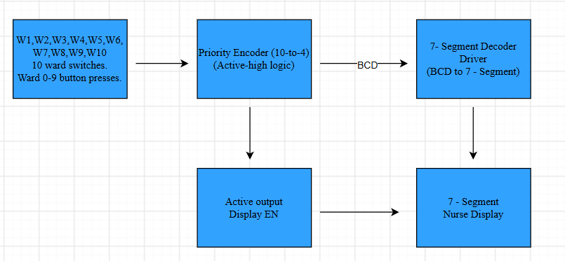
*Figure 1: Block diagram*

The design is a three-stage digital logic flow:

| Stage | Description |
|-------|-------------|
| **Input** | Ten momentary push-buttons (W1 to W10), one per ward, at 0 V / 5 V TTL/CMOS levels, **active-HIGH**. Contact bounce (typically 5 to 20 ms) is handled by an RC filter or a software delay-and-recheck. |
| **Processing** | A 10-to-4 **priority encoder** resolves simultaneous presses in favour of the higher-numbered ward and outputs a 4-bit BCD value. An OR-logic block produces the display-enable signal **V** (called EN in the diagram). |
| **Output** | A BCD-to-7-segment decoder drives the nurse display, **only when V = 1**. With no button pressed V = 0 and the display stays off. |

## A2. Truth table and Boolean equations

The table is in compressed form: with a priority encoder, the lower-priority inputs are don't-cares (X) once a higher one is active, so 2^10 = 1024 combinations reduce to 11 rows (the same structure as the 74148 priority encoder IC).

| S10 | S9 | S8 | S7 | S6 | S5 | S4 | S3 | S2 | S1 | A3 A2 A1 A0 | V |
|:--:|:--:|:--:|:--:|:--:|:--:|:--:|:--:|:--:|:--:|:-----------:|:-:|
| 0 | 0 | 0 | 0 | 0 | 0 | 0 | 0 | 0 | 0 | 0000 | 0 |
| 0 | 0 | 0 | 0 | 0 | 0 | 0 | 0 | 0 | 1 | 0001 | 1 |
| 0 | 0 | 0 | 0 | 0 | 0 | 0 | 0 | 1 | X | 0010 | 1 |
| 0 | 0 | 0 | 0 | 0 | 0 | 0 | 1 | X | X | 0011 | 1 |
| 0 | 0 | 0 | 0 | 0 | 0 | 1 | X | X | X | 0100 | 1 |
| 0 | 0 | 0 | 0 | 0 | 1 | X | X | X | X | 0101 | 1 |
| 0 | 0 | 0 | 0 | 1 | X | X | X | X | X | 0110 | 1 |
| 0 | 0 | 0 | 1 | X | X | X | X | X | X | 0111 | 1 |
| 0 | 0 | 1 | X | X | X | X | X | X | X | 1000 | 1 |
| 0 | 1 | X | X | X | X | X | X | X | X | 1001 | 1 |
| 1 | X | X | X | X | X | X | X | X | X | 1010 | 1 |

**Boolean equations** (`'` = NOT, `·` = AND, `+` = OR). Each priority term P*n* is true only when ward *n* is the highest-priority active ward:

```
V  = S1 + S2 + S3 + S4 + S5 + S6 + S7 + S8 + S9 + S10

P1  = S1 · S2' · S3' · S4' · S5' · S6' · S7' · S8' · S9' · S10'
P2  = S2 · S3' · S4' · S5' · S6' · S7' · S8' · S9' · S10'
...
P9  = S9 · S10'
P10 = S10

A3 = P8 + P9 + P10            (= S8 + S9 + S10 after simplification)
A2 = P4 + P5 + P6 + P7
A1 = P2 + P3 + P6 + P7 + P10
A0 = P1 + P3 + P5 + P7 + P9
```

## A3. Structural Verilog model

Source: [`nurse_alert_structural.v`](nurse_alert_structural.v)

Built from explicit gate primitives: nine `not` gates for the complements of S2 to S10, one `or` for V, `and` gates for P1 to P9, a `buf` for P10 (highest priority, no exclusion terms), then `or` gates for the four BCD outputs.

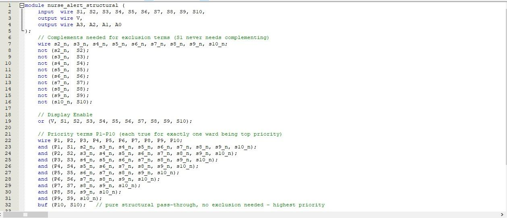
*Figure 2: Structural model in Quartus II*

**Testbench:** [`tb_nurse_alert_structural.v`](tb_nurse_alert_structural.v) applies five vectors: idle, Ward 1, Wards 1+2 (Ward 2 wins), Ward 7, and Wards 1+10 (Ward 10 wins).

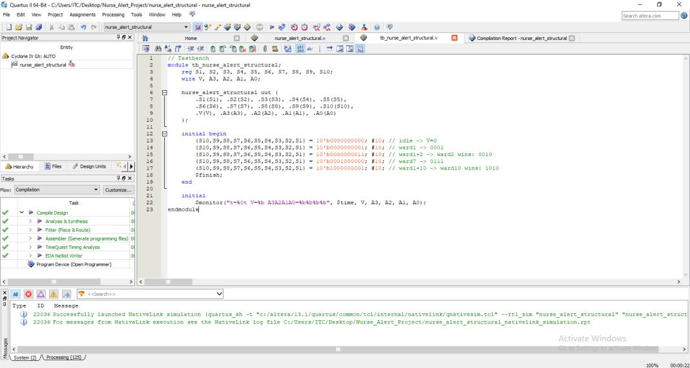
*Figure 3: Structural testbench*

**Compilation:** Quartus II compiled with 0 errors and 4 non-critical warnings (unconstrained timing, expected for purely combinational logic). The design uses **11 of 14,400 logic elements** on the Cyclone IV GX `EP4CGX15BF14C6`.

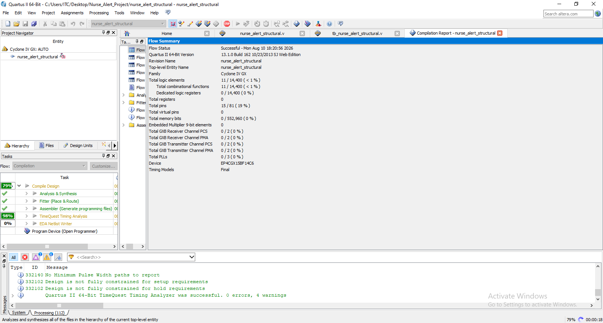
*Figure 4: Quartus II flow summary*

**Simulation:** the last vector (S1 = 1 and S10 = 1) gives `A3A2A1A0 = 1010` and `V = 1`, so Ward 10 correctly wins.

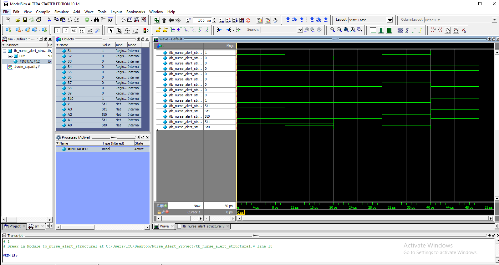
*Figure 5: ModelSim waveform, structural model*

## A4. Dataflow Verilog model

Source: [`nurse_alert_dataflow.v`](nurse_alert_dataflow.v)

The same logic written with continuous `assign` statements and Boolean operators (`|`, `&`, `~`). It has about half the lines and is much easier to read, while synthesising to equivalent hardware.

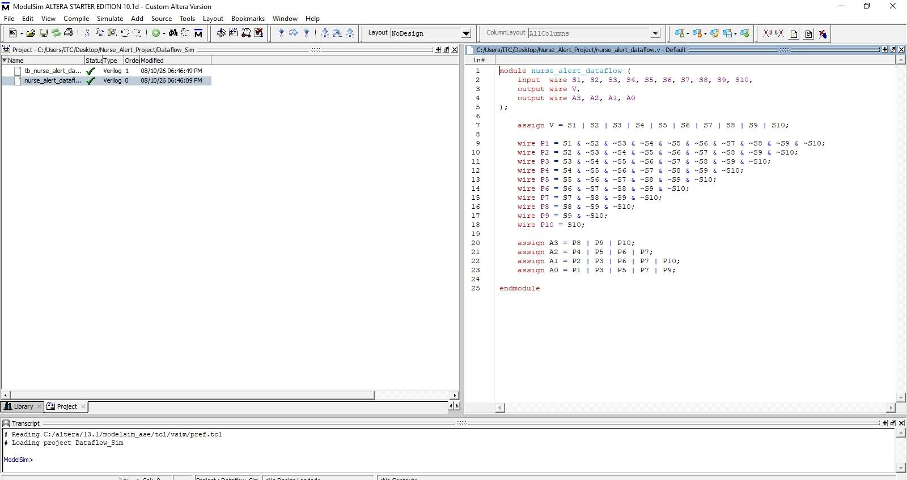
*Figure 6: Dataflow model in ModelSim*

**Testbench:** [`tb_nurse_alert_dataflow.v`](tb_nurse_alert_dataflow.v) applies six vectors: idle, Ward 1, Wards 1+2, Ward 7, Ward 8, Wards 1+10.

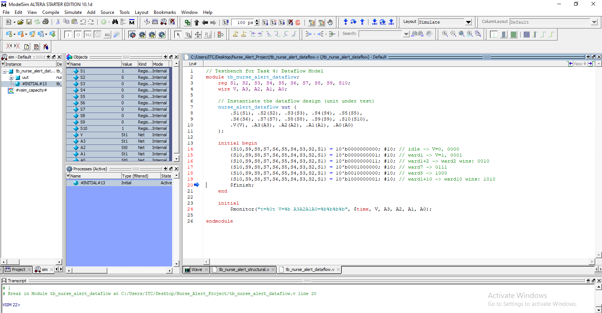
*Figure 7: Dataflow testbench*

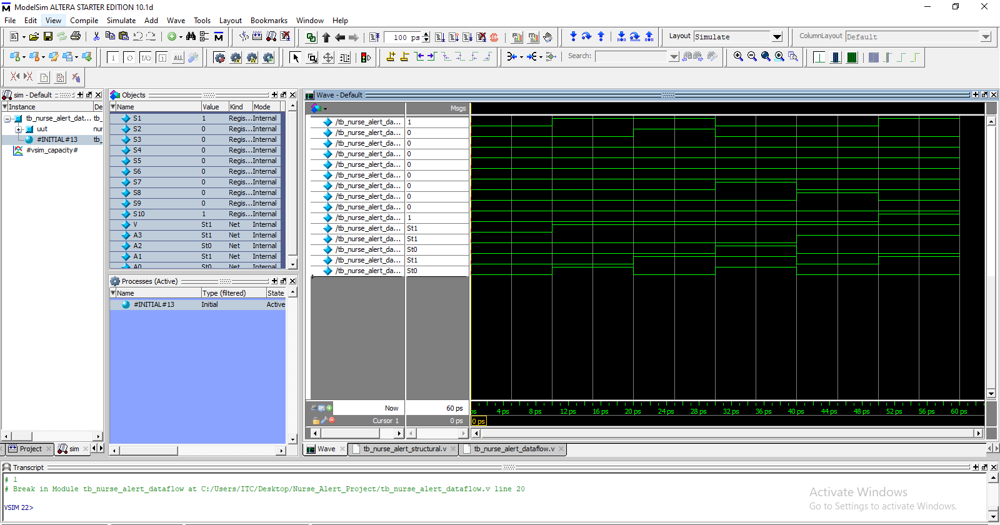
*Figure 8: RTL simulation waveform of the dataflow priority encoder. Final state at t = 60 ps: V = 1, A3A2A1A0 = 1010, matching the structural model.*

## A5. Section A discussion

- **Structural vs dataflow.** The structural model mirrors a gate schematic and is easy to check against the equations, but it is long and error-prone as the exclusion chains grow. The dataflow model gives the same result with better readability, and synthesis tools optimise both to a similar gate-level result, so readability costs no performance.
- **Fixed priority.** The brief does not define simultaneous presses, so a fixed scheme (higher ward number wins, like the 74148) was used. A limitation is that Ward 1 could in principle wait indefinitely if higher wards keep calling. Round-robin, timestamped queues or urgency-weighted inputs would address this but are beyond scope.
- **Hazards.** Purely combinational logic can show brief glitches while gate delays settle. At mechanical switch speeds the risk is low, and the PIC's debounce delay reduces it further.
- **Verification coverage.** The testbenches cover idle blanking and two-switch conflicts at the boundary priorities (Ward 1 vs 2, Ward 1 vs 10). Not covered: all adjacent-priority pairs (e.g. Ward 5 vs 6) and three or more simultaneous inputs. A fuller verification would test all of these.

---

# Section B: Embedded system

## B1. Design choices

### Methodology: V-Model
The V-Model (Pressman, 2009) pairs each development phase (requirements, architecture, module design, implementation) with a verification phase. It suits this project because requirements are fixed from the start and hardware cannot be reconfigured like software. The truth table verified in Section A serves as the known-good reference for checking the firmware's priority routine. Agile was rejected because it targets changing requirements and iterative sprints.

### Sensors: momentary push-buttons
A binary call-request signal per ward, read as 0 V / 5 V with a pull-down resistor (active-HIGH).

| Option | Verdict |
|--------|---------|
| Capacitive touch | No moving parts, but needs a touch-controller IC and moisture/humidity calibration: extra cost and complexity for a binary signal |
| IR break-beam ("wave to call") | Prone to false triggers from normal patient movement and awkward to mount in each ward |
| **Mechanical push-button** | Tactile, cheap, reliable, immune to electrical noise. Needs debouncing, done in firmware |

### Actuators
| Actuator | Implementation |
|----------|----------------|
| Dual 7-segment display | Units digit via **74LS47** BCD decoder; tens digit "1" driven directly from **RC5**, so "10" displays without a second decoder IC |
| Piezo buzzer | Switched through a **BC547** NPN transistor (PIC pins cannot supply enough current) |
| Status LED | "Alert active" cue visible from a wide angle |

Hard-wired, dual-channel (visual + audible) notification remains relevant for fixed installations even as wireless wearables emerge (Riyad et al., 2021).

### Control technique: polling with software debounce
Inputs are polled in a continuous loop with a **20 ms** delay-and-recheck debounce (typical bounce is 5 to 20 ms). Interrupts were considered for lower power, but polling was chosen because (a) the PIC is mains-powered in a fixed installation, so low power is not critical; (b) polling gives simpler, more predictable and easier-to-verify timing for a safety-relevant function; and (c) the priority routine needs less supporting hardware.

Priority is resolved by an `if / else if` chain from Ward 10 down to Ward 1, matching the Section A encoder. The highest-priority ward is **latched** and held until the nurse presses Clear, so a call is never lost when the patient releases the button.

### Microcontroller: PIC16F877A
20 MHz, 8K words of Flash, 33 I/O pins, 10-bit ADC, SPI/USART, timers and interrupts (Ismaeel, Yousif and Abdallh, 2013).

| Criterion | PIC16F877A | PIC16F84A | PIC16F628A |
|-----------|:----------:|:---------:|:----------:|
| I/O pins | 33 | 13 | 16 |
| Program memory | 8K words | 1K words | 2K words |
| ADC channels | 8 (10-bit) | None | None |
| Suitable? | **Yes** | No (too few I/O) | No (too few I/O) |

The design uses 19 pins (10 ward inputs, 1 Clear, 4 BCD, 1 blanking, 1 tens digit, 1 buzzer, 1 LED), leaving 14 spare for expansion.

## B2. Hardware architecture

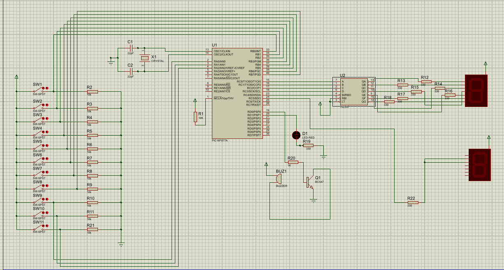
*Figure 9: Complete Proteus schematic*

### Pin map
| Signal | Pin | Notes |
|--------|-----|-------|
| SW1 to SW8 (Wards 1 to 8) | RB0 to RB7 | Active-HIGH, 10 kΩ pull-downs (R2 to R9) |
| SW9, SW10 (Wards 9, 10) | RA0, RA1 | Active-HIGH, 10 kΩ pull-downs |
| SW11 (Clear / acknowledge) | RA2 | Active-HIGH, 10 kΩ pull-down (R21) |
| BCD to 74LS47 | RC0 to RC3 | Units digit |
| Units display blanking | RC4 | To 74LS47 BI/RBO (active-LOW blank), so 1 = display on |
| Tens digit "1" | RC5 | Segments b and c tied together via 330 Ω (R22), 0 = lit |
| Buzzer | RD0 | Via BC547 (Q1) with 1 kΩ base resistor (R20) |
| Status LED | RD1 | Via 330 Ω (R19) |
| Clock | OSC1/OSC2 | 20 MHz crystal (X1) with 22 pF caps (C1, C2); R1 (10 kΩ) holds MCLR high |

### Input stage
Eleven momentary switches connect between +5 V and the PIC input pin, each with a 10 kΩ pull-down to ground, giving a defined LOW when open and HIGH when pressed (no floating pins).

### Processing stage
The PIC polls all ten ward inputs, resolves priority from Ward 10 downward, stores the winner in `latched_ward`, and keeps driving the outputs after the button is released until SW11 is pressed.

### Output stage
- **Units digit:** a 4-bit BCD code from RC0 to RC3 to the 74LS47 (U2), through 330 Ω resistors (R12 to R18) to a common-anode display. RC4 blanks the display when idle.
- **Tens digit:** a second common-anode display with segments b and c joined and driven from RC5 through R22. It lights only for Ward 10 (RC5 = 0). For Wards 1 to 9 and idle, RC5 = 1 and the tens digit stays dark.
- **Buzzer and LED:** on while a call is latched, off after Clear.

### Why latching and Clear (SW11)
The first prototype showed the ward number only while the button was held, so a nurse glancing away could miss a brief press. The firmware now **latches** the call until staff acknowledge it with SW11. This mirrors hospital annunciator panels, fire-alarm panels and SCADA alarms, changing the behaviour from "a call happened" to "a call has been handled". If a **higher-priority** ward calls while a lower one is latched, the display switches to the higher ward automatically, without needing a Clear first.

## B3. Firmware

Source: [`main.c`](main.c), written in C for the Microchip **XC8** compiler (v3.10) in **MPLAB X IDE** (v6.35).

```c
// Core loop (see main.c for the full listing)
while (1) {
    // 1. Clear button
    if (CLEAR_BUTTON == 1) {
        __delay_ms(20);
        if (CLEAR_BUTTON == 1) { call_active = 0; latched_ward = 0; }
    }

    // 2. Ward switches: debounce, latch, or override with a higher priority
    uint8_t current_ward = get_active_ward();
    if (current_ward > 0) {
        __delay_ms(20);
        current_ward = get_active_ward();
        if (current_ward > 0 && (!call_active || current_ward > latched_ward)) {
            latched_ward = current_ward;
            call_active = 1;
        }
    }

    // 3. Output stage: one byte write to PORTC updates both digits together
    if (call_active) {
        PORTC = (latched_ward == 10) ? 0x10 : (0x30 | (latched_ward & 0x0F));
        ALERT_LED = 1;  BUZZER_PIN = 1;
    } else {
        PORTC = 0x20;
        ALERT_LED = 0;  BUZZER_PIN = 0;
    }
}
```

### PORTC output encoding
| State | PORTC | RC5 (tens) | RC4 (units enable) | RC3..RC0 (BCD) | Display |
|-------|:-----:|:----------:|:------------------:|:--------------:|---------|
| Idle / after Clear | `0x20` | 1 (off) | 0 (blank) | 0000 | blank |
| Wards 1 to 9 | `0x30 \| ward` | 1 (off) | 1 | ward | units digit only |
| Ward 10 | `0x10` | 0 (lit "1") | 1 | 0000 | "1" + "0" = **10** |

A single byte write to PORTC updates both digits atomically on each loop pass.

### Build results
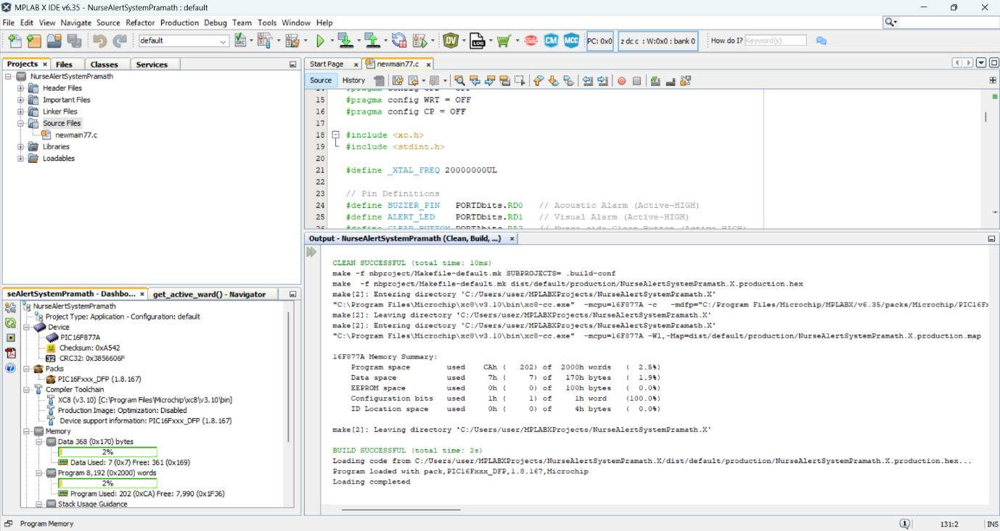
*Figure 10: MPLAB X build output (final firmware)*

| Metric | Result |
|--------|--------|
| Build | 0 errors, 0 warnings |
| Program memory | 202 words (0xCA) of 8,192, about **2.5%** |
| Data RAM | 7 bytes of 368, about **1.9%** |

## B4. Simulation results (Proteus)

The simulation loads `NurseAlertSystem_X_production.hex`.

### Idle state
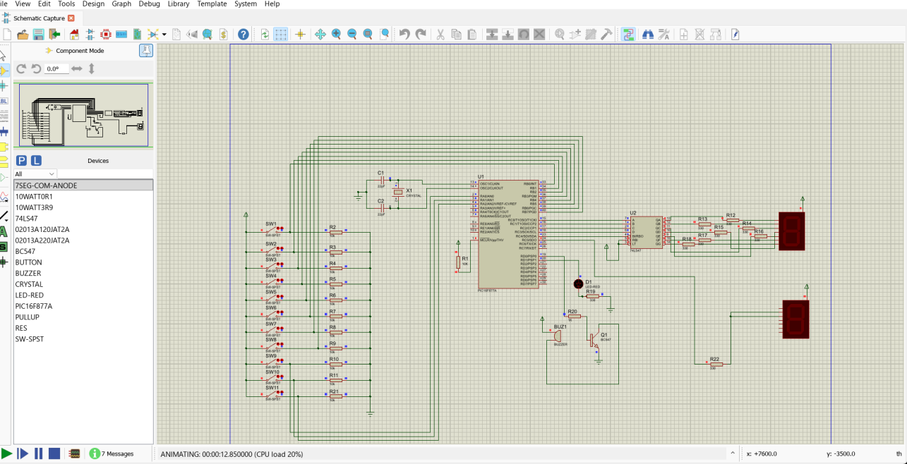
*Figure 11: Idle state*

No switch pressed: `PORTC = 0x20`, the units digit is blanked, the tens digit is off, and the buzzer and LED are off. All eleven switch inputs read LOW and no stray segments are lit.

### Ward 3 call
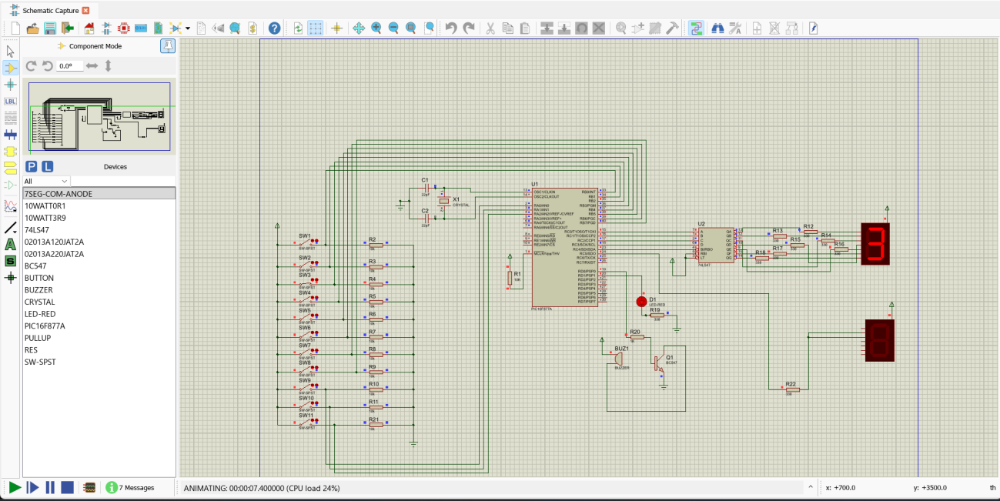
*Figure 12: SW3 pressed*

Output is `PORTC = 0x30 | 3`: the units digit shows **3**, the tens digit stays dark, and the LED and buzzer turn on.

### Latch confirmation
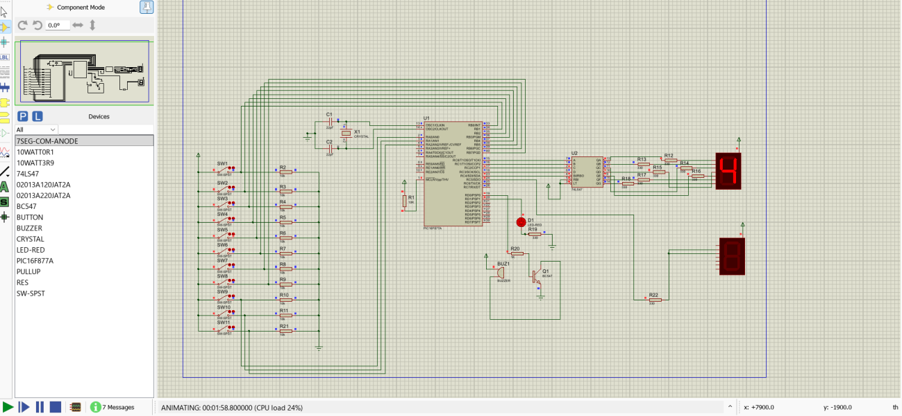
*Figure 13: SW4 pressed and released*

After releasing the button, **4** stays on the units digit and the LED stays lit. The latch holds until Clear is pressed.

### Priority override
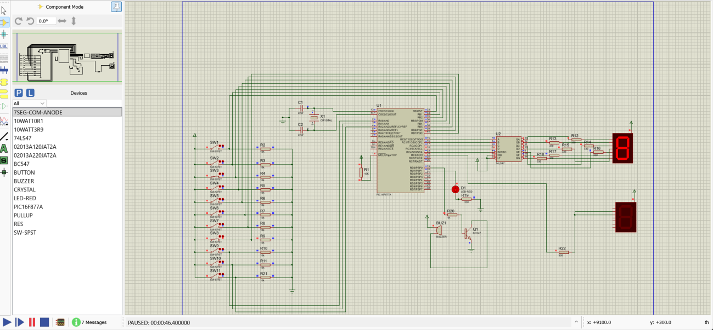
*Figure 14: Ward 8 overrides latched Ward 3*

Ward 3 was latched and not cleared. Pressing Ward 8 changes the display from 3 to **8**, confirming the `current_ward > latched_ward` condition.

### Ward 10 (two-digit display)
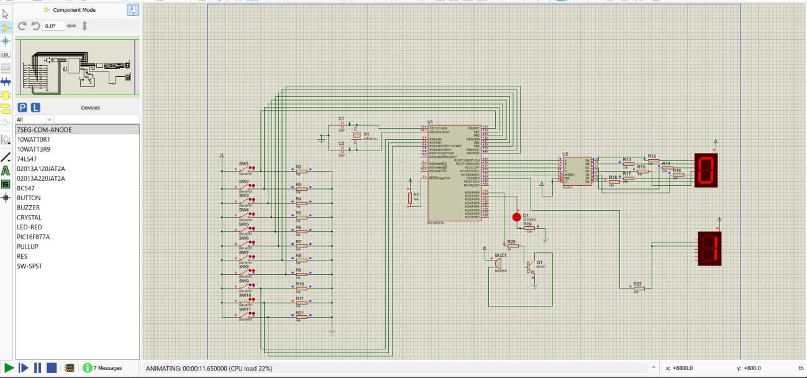
*Figure 16: Ward 10 call*

`PORTC = 0x10`: the units digit shows **0** and the tens digit shows **1**, giving an unambiguous "10" instead of relying on a lone "0" as a convention.

### Clear
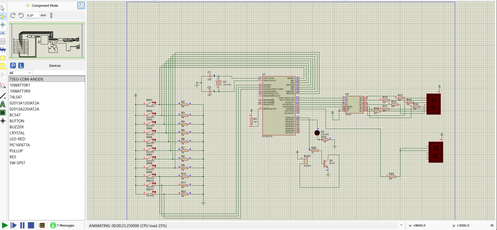
*Figure 15: Clear (SW11) pressed after a Ward 10 call*

Both digits blank, the LED turns off and the buzzer goes silent. `call_active` and `latched_ward` reset to 0 and the system is ready for the next call.

---

# How to run

**Simulation (Proteus)**
1. Open `PIC-based_nurse_alert_system.pdsprj`.
2. Double-click the PIC16F877A and set its *Program File* to `NurseAlertSystem_X_production.hex`.
3. Run the simulation, toggle the ward switches, and use SW11 to clear.

**Rebuild the firmware (MPLAB X)**
1. Create a new MPLAB X project for the PIC16F877A with the XC8 compiler.
2. Add `main.c` and build.

**Verilog simulation (ModelSim)**
1. Compile a model and its testbench together, e.g. `nurse_alert_dataflow.v` with `tb_nurse_alert_dataflow.v`.
2. Simulate `tb_nurse_alert_dataflow` and watch V and A3..A0 in the waveform or `$monitor` output.

---

# Critical analysis

### Software vs hardware priority resolution
The first version used a dedicated **74HC147** priority encoder, with the PIC reading its encoded output. That saves I/O pins (four instead of nine or ten) and offloads the MCU, but the 74HC147 has only **nine inputs**, so Ward 10 would need a special case around it, and its **active-LOW** outputs need inverters or firmware correction. The PIC16F877A has I/O to spare, so resolving priority entirely in software is simpler and more flexible, with no real cost for a polled, non-time-critical task.

### Momentary to latching design
Latching changes the system from reporting the current button state to tracking **unacknowledged calls**, which matters clinically because a brief press must not vanish unseen. It adds a failure mode: if the Clear input is held continuously (possible with the toggle switch used in simulation), the system clears on every loop and **can never latch a new call**. Real hardware should use a **momentary** Clear button.

### Priority override and call queue
A higher-priority call replaces a lower unacknowledged one without a Clear first, so the most urgent call is always shown. The trade-off is that the overridden call is still outstanding but no longer visible. A real deployment would need a **call queue or log** of all pending calls, which is listed as future work.

### Simulation component limitation
Proteus's standard `BUTTON` component acts as a single-cycle pulse and does not hold a pressed state, so `SW-SPST` toggle switches were used in simulation. They are electrically equivalent for this digital design. The intended real hardware is still momentary push-buttons.

### Dual 7-segment implementation
A single digit showing "0" for Ward 10 was ambiguous for staff. A second display was added for the tens place, with segments b and c driven directly by RC5. This avoids a second 74LS47 decoder (4 more I/O pins and board space). Segments b and c share one 330 Ω resistor for simplicity; on physical hardware, **one resistor per segment** would give more even brightness despite LED forward-voltage tolerance, and is a production refinement.

### Future work
- Call queue / log of all pending calls
- Momentary Clear button with a "stuck button" fault indication
- Round-robin or urgency-weighted priority to avoid starving Ward 1
- UART telemetry or event logging (over 97% of Flash and 98% of RAM are free)
- Individual current-limiting resistors per display segment

---

# References

- Ismaeel, A.G., Yousif, R.Z. and Abdallh, E.F. (2013) 'GUI based automatic remote control of gas reduction system using PIC microcontroller', *International Journal of Engineering Science and Technology*, 3(2), pp. 217-227.
- Pressman, R.S. (2009) *Software Engineering: A Practitioner's Approach*. 7th edn. New York: McGraw-Hill.
- Riyad, O.F., Sharif, A., Suhan, A.C. and Khan, M.M. (2021) 'An IoT based nurse calling system for real-time emergency alert using local wireless network', in *2021 IEEE 12th Annual Ubiquitous Computing, Electronics & Mobile Communication Conference (UEMCON)*. IEEE, pp. 924-929.

# AI assistance disclosure
Claude (Anthropic) was used for debugging assistance, drafting support and literature source identification. All final technical decisions, verification testing and analytical conclusions are the author's own, developed through hands-on circuit debugging, code testing and iterative refinement.

# Acknowledgement
Thanks to Mr. Asitha for mentoring and encouragement, and to Liverpool John Moores University and ICBT for the opportunity to study engineering.
